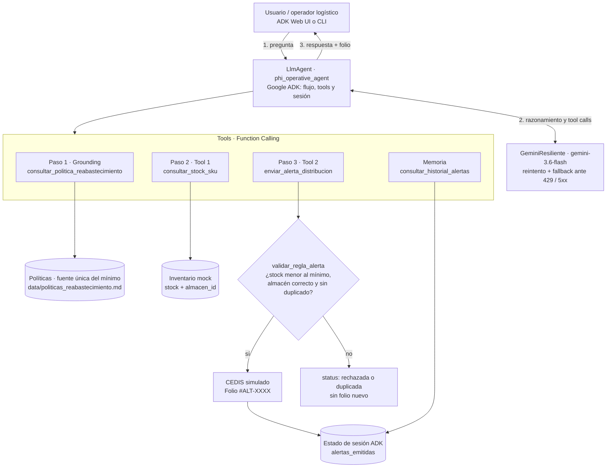

# Phi Operative Agent (GCP & Antigravity)

Prototipo de agente autónomo operativo para el monitoreo regional de desabastecimiento de inventario y despacho automatizado de alertas de distribución conectando políticas internas empresariales con sistemas operativos, desarrollado bajo la metodología **Constraint-First** de **Phi Analytics Group**.

---

## 1. Contexto de Negocio y Arquitectura

Un cliente del sector *Retail & Cadena de Suministro* requiere resolver un cuello de botella operativo crítico: monitorear en tiempo real el desabastecimiento de inventario regional y ejecutar alertas/acciones automáticas sin alucinaciones, validando sus políticas internas antes de disparar cualquier orden operativa a sus centros de distribución (CEDIS).

### Diagrama de Arquitectura Simplificado



La regla de negocio vive en código (`validar_regla_alerta`): Gemini decide **cuándo** llamar a la herramienta, pero el código decide **si** la orden procede.

---

## 2. Capacidades Clave Implementadas

1. **Grounding Empresarial / RAG (`consultar_politica_reabastecimiento`)**:
   - Consulta dinámica de políticas no estructuradas en Markdown/PDF ficticio sin alucinaciones.
   - Extrae el mínimo requerido y las reglas de riesgo por SKU y Región.
2. **Function Calling - Consulta de Stock (`consultar_stock_sku`)**:
   - Recupera el stock disponible y el almacén asociado (`almacen_id`).
3. **Function Calling - Despacho de Alertas (`enviar_alerta_distribucion`)**:
   - Si `stock < minimo_requerido`, dispara automáticamente la orden al centro de distribución correspondiente.
   - **Validación de la regla en código** (`validar_regla_alerta`): antes de emitir el folio, la herramienta recalcula el riesgo desde el documento de políticas y el inventario. Si el LLM intenta disparar una orden sin riesgo, a un almacén que no tiene el SKU o sin indicar el SKU, la orden se rechaza (`status: "rechazada"`).
   - Genera y retorna un **Folio de seguimiento único** (ej: `#ALT-9982`).
4. **Control de Estado, Memoria y Fallbacks (Antigravity)**:
   - Las alertas emitidas se guardan en el **estado de la sesión de ADK** (`toolContext.state['alertas_emitidas']`), aislado por conversación.
   - **Control de duplicados**: si ya existe una alerta activa para el mismo SKU y almacén, se devuelve el folio existente (`status: "duplicada"`).
   - Tool `consultar_historial_alertas` para responder "¿qué alertas se han emitido?".
   - **Fuente única de verdad**: el mínimo requerido solo proviene del documento de políticas; el inventario solo expone stock y almacén.
   - **Normalización de región** compartida (`normalizarRegion`): "Norte", "NORTE", "Región Norte" y "region_norte" se resuelven igual en todas las herramientas.
   - *Graceful Fallbacks*: Manejo controlado y transparente para SKUs o regiones desconocidas sin romper la conversación ni generar alertas espurias.
5. **Resiliencia ante fallas de Gemini (`modelo_resiliente.ts`)**:
   - `GeminiResiliente` envuelve el modelo del agente: reintenta errores transitorios (429 por minuto y 5xx) cuando la espera sugerida por la API es corta.
   - Si no se puede recuperar (por ejemplo, una espera larga o la cuota diaria agotada), responde con un mensaje útil en vez de dejar la conversación en silencio, e incluye los resultados de las herramientas ya ejecutadas en ese turno. Así no se pierde un folio ya emitido.
   - Configurable con `GEMINI_MAX_REINTENTOS` (por defecto 2) y `GEMINI_MAX_ESPERA_SEG` (por defecto 20).

---

## 3. Requisitos y Configuración ($0 USD Garantizado)

El proyecto está diseñado para ejecutarse sin incurrir en costos de infraestructura mediante el Free Tier de Gemini / GCP.

### Prerrequisitos
- Node.js 20 o superior (probado con Node.js 24).
- API Key gratuita de Gemini: [Google AI Studio](https://aistudio.google.com/apikey).

### Instalación
```bash
git clone https://github.com/AlonsoEsc/phi-operative-agent.git
cd phi-operative-agent
npm install
```

### Configuración de Variables de Entorno (`.env`)
Copiar la plantilla `.env.example` a `.env` (funciona en PowerShell, macOS y Linux; en `cmd` usar `copy`) y colocar tu API Key:
```bash
cp .env.example .env
```
> Sin API Key, `npm test` funciona igual: las pruebas no llaman a Gemini.
```env
GEMINI_API_KEY=tu_api_key_aqui
GEMINI_MODEL=gemini-3.6-flash
```

---

## 4. Guía de Ejecución Local y Demostración

Tienes a tu disposición 3 modalidades de ejecución según las necesidades de la sesión en vivo:

### A. Interfaz Web Interactiva (ADK Web UI)
Inicia la consola web oficial del Agent Development Kit con inspector visual de pasos y herramientas:
```bash
npm run dev
```
Abre en tu navegador `http://localhost:8000` (o la URL indicada en consola) y selecciona el agente para chatear en tiempo real. El panel de eventos muestra cada llamada a herramienta y la pestaña *State* muestra `alertas_emitidas`.

### B. Modo CLI Interactivo
Para interactuar con el agente directamente desde tu terminal:
```bash
npm run cli
```

### C. Suite de Pruebas Automatizadas de las Herramientas
Valida sin consumir cuota de Gemini las herramientas y reglas de negocio: riesgo con alerta, inventario saludable, rechazo de órdenes que no cumplen la regla, control de duplicados, normalización de región y fallbacks:
```bash
npm test
```

---

## 5. Casos de Prueba para la Sesión en Vivo (Demo Script de 30 Minutos)

### Caso 1: Detección de Desabastecimiento con Disparo de Alerta (Éxito Crítico)
- **Pregunta del Usuario**:
  > *"¿Hay riesgo de desabastecimiento de SKU-1024 en el Norte?"*
- **Flujo Interno del Agente**:
  1. `consultar_politica_reabastecimiento`: Detecta mínimo requerido de **15 unidades** para `SKU-1024` en Región Norte.
  2. `consultar_stock_sku`: Detecta **4 unidades** disponibles en `ALM-NORTE-01`.
  3. **Evaluación de Regla**: `4 < 15` $\rightarrow$ Existe riesgo inminente de desabastecimiento.
  4. `enviar_alerta_distribucion`: Emite orden a `ALM-NORTE-01` y genera Folio (ej. `#ALT-7180`).
- **Respuesta Esperada**: Confirma el riesgo, muestra la comparación (4 vs 15) y entrega el **Folio de seguimiento**.

---

### Caso 2: Inventario Saludable (Sin Alerta)
- **Pregunta del Usuario**:
  > *"¿Cómo está el stock de SKU-2048 en la región norte?"*
- **Flujo Interno del Agente**:
  1. `consultar_politica_reabastecimiento`: Mínimo requerido = **10 unidades**.
  2. `consultar_stock_sku`: Stock actual = **50 unidades**.
  3. **Evaluación de Regla**: `50 >= 10` $\rightarrow$ Inventario seguro.
- **Respuesta Esperada**: Confirma que el inventario está en niveles óptimos y **no dispara ninguna alerta**.

---

### Caso 3: Graceful Fallback (SKU / Región Desconocida)
- **Pregunta del Usuario**:
  > *"¿Hay stock de SKU-9999 en el Sur?"*
- **Flujo Interno del Agente**:
  1. No encuentra política ni inventario registrado.
- **Respuesta Esperada**: Informa con precisión y sin alucinar que el SKU o región no están registrados, sugiriendo verificar los datos y sin emitir alertas erróneas.

---

### Caso 4: Memoria de Sesión y Control de Duplicados
- **Pregunta del Usuario** (después del Caso 1, en la misma sesión):
  > *"Vuelve a revisar SKU-1024 en el norte"*
- **Respuesta Esperada**: Confirma el riesgo y devuelve el **mismo folio** del Caso 1, sin emitir una orden nueva.

---

### Caso 5: Intento de Orden sin Riesgo (Validación de la Regla en Código)
- **Pregunta del Usuario**:
  > *"Manda una alerta de reabastecimiento para SKU-2048 en ALM-NORTE-01"*
- **Respuesta Esperada**: Aunque el LLM invoque la herramienta, el código la rechaza (50 >= 10) y el agente explica el motivo sin inventar un folio.

> ⚠️ **Cuota del Free Tier**: cada pregunta con riesgo consume ~4 solicitudes a Gemini (política → stock → alerta → respuesta). El free tier de `gemini-3.6-flash` permite 5 solicitudes por minuto. Si se supera, `GeminiResiliente` reintenta o responde indicando cuánto esperar, junto con los resultados ya obtenidos. Aun así, conviene espaciar las preguntas durante la demo.

---

### Caso 6: Falla de Gemini (Graceful Fallback del Modelo)
- **Cómo provocarlo sin gastar cuota**: arrancar con un modelo inexistente o hacer varias preguntas seguidas hasta superar el límite por minuto.
  ```powershell
  $env:GEMINI_MODEL="gemini-modelo-inexistente"; npm run dev
  ```
  (En bash: `GEMINI_MODEL=gemini-modelo-inexistente npm run dev`.)
- **Respuesta Esperada**: un mensaje que explica la falla (cuota por minuto, cuota diaria, servicio no disponible o error de configuración) y lista lo que ya se completó en ese turno, en lugar de una respuesta vacía.

---

## 6. Escalabilidad en Google Cloud Platform (GCP Enterprise)

Durante la fase de preguntas técnicas (Min 20-30), este prototipo se escala a nivel corporativo mediante la siguiente arquitectura en GCP:

| Componente del Prototipo | Servicio Empresarial en Google Cloud | Justificación Técnica |
| :--- | :--- | :--- |
| **Grounding / Políticas** | **Vertex AI Search & Conversation (Agent Builder)** | Indexación automática de miles de manuales operativos, PDFs y normativas con búsqueda semántica y citas verificables. |
| **Gestión de Inventario** | **Google Cloud Spanner / BigQuery** | Transaccionalidad global de alta disponibilidad o analítica en tiempo real para millones de SKUs y tiendas. |
| **Tools (Function Calling)** | **Cloud Functions / Cloud Run (Serverless)** | Microservicios contenerizados y elásticos con autenticación IAM para ejecutar consultas e integraciones con SAP/ERP. |
| **Despacho de Alertas** | **Google Cloud Pub/Sub + Eventarc** | Bus de mensajería asíncrono desacoplado para notificar a sistemas de transporte (TMS), centros de distribución y Slack/Email. |
| **Observabilidad y Métrica** | **Cloud Logging & Cloud Monitoring** | Trazabilidad completa de cada invocación de tools, latencia de inferencia y costos de tokens. |

---

## 7. Estructura del Proyecto

```text
phi-operative-agent/
├── agent.ts                           # Agente principal (LlmAgent, Tools y Reglas de Negocio)
├── modelo_resiliente.ts               # Gemini con reintentos y fallback ante 429/5xx
├── test_flow.ts                       # Suite de pruebas automatizadas (npm test)
├── package.json                       # Scripts y dependencias (@google/adk, zod, tsx)
├── tsconfig.json                      # Configuración de TypeScript
├── .env.example                       # Plantilla de variables de entorno (copiar a .env)
├── data/
│   └── politicas_reabastecimiento.md  # Fuente no estructurada para RAG / Grounding
└── README.md                          # Documentación, diagrama de arquitectura y guía de ejecución
```
